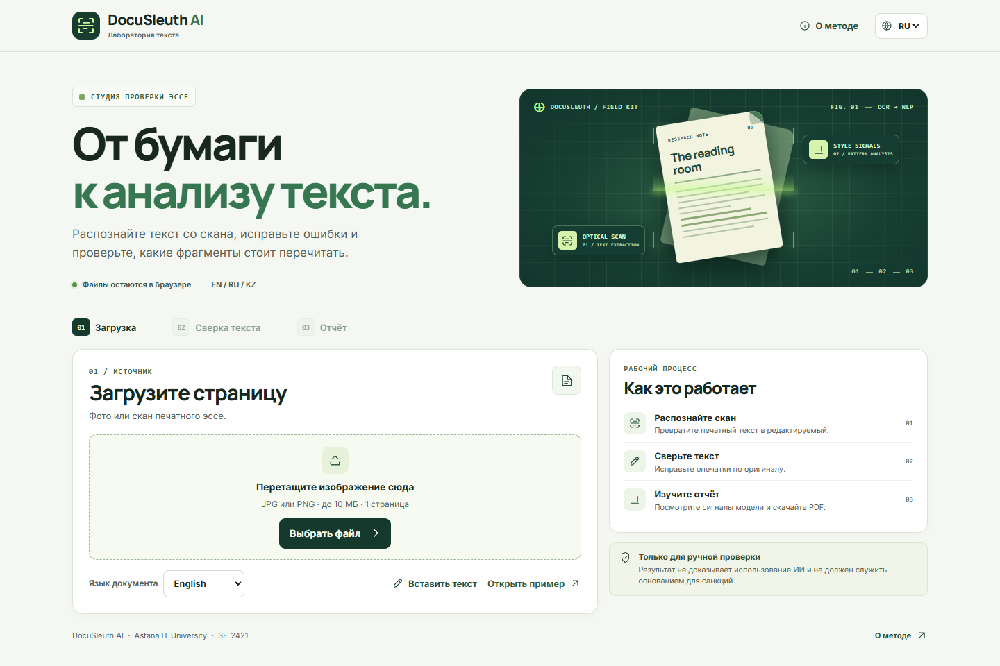

# DocuSleuth AI

Review printed essays in **English, Russian and Kazakh**. Upload a scan, check the transcription, explore text signals and download a PDF report.

**[Open the live demo](https://kerey404.github.io/docusleuth-ai/)** · [Final project evidence](docs/final-project/README.md) · [Model validation](VALIDATION.md) · [Инструкция на русском](docs/README.ru.md)



Built for the **SE-2421 Project Management team at Astana IT University**. The application combines multilingual OCR, browser inference and a documented review workflow. Uploaded essays are processed in the visitor's browser.

## Try the complete workflow

1. Open the live demo in Chrome or Edge and select the document language.
2. Load a built-in example or upload a clear JPG/PNG scan. Pasted text is also supported.
3. Compare the transcription with the image and correct OCR errors.
4. Run the analysis, read the model signal and review highlighted passages.
5. Download the PDF and repeat with another language.

| Capability | Available in the prototype |
| --- | --- |
| Document languages | English, Russian and Kazakh across the interface, OCR and models |
| Input | One JPG/PNG image up to 10 MB and 40 megapixels, or pasted text |
| Analysis length | 200–2,000 words, up to 100,000 characters |
| Review | Editable transcription, model index, uncertainty band and highlighted text groups |
| Export | PDF with extractable text and Cyrillic/Kazakh glyph support |
| Processing | OCR, scoring and PDF generation run in the browser |

The 0–100 index expresses a model signal. The interface includes an inconclusive range and supports manual review. Authorship decisions require independent evidence, and the output must never be used as the sole basis for a misconduct penalty. Clear printed scans are the intended input. Handwriting, mixed-language documents and real classroom photographs need further validation.

## Model results and limitations

Russian and Kazakh models use version 2.0. English uses version 1.0. The training sets contain **5,290 RU**, **1,265 KZ** and **2,537 EN** texts. Recorded experiments compared 47 Russian and 33 Kazakh variants, including linear models, tree ensembles and combinations of their outputs. OCR uses pretrained Tesseract language packs.

| Evaluation slice | Version 1.0 misses | Version 2.0 misses |
| --- | ---: | ---: |
| Russian paraphrased essays | 44 / 86 | 15 / 86 |
| Russian paraphrased news | 40 / 47 | 23 / 47 |
| Kazakh AI text from other genres | 46 / 187 | 24 / 187 |

A miss includes an inconclusive result on a labelled AI example. Version 2.0 falsely flagged **2 of 85 human Russian essays** and **1 of 95 human Kazakh encyclopedic passages**. These small, domain-specific controls leave substantial uncertainty about classroom performance.

The Kazakh human control set covers encyclopedic writing. Independent human Kazakh student essays remain a data gap. The 64 humanized-text test cases contain 80–199 words, below the application's 200-word minimum. Legacy tests were reused, and CoAT topic overlap remains unresolved. The project records these limits alongside its results. [Full validation and data sources](VALIDATION.md)

## Final project materials

The Agile report models four two-week sprints as an **academic execution simulation**. Its story outcomes and daily hours describe that exercise. Published code and validation records provide evidence for the working prototype.

| Material | What it contains |
| --- | --- |
| [Live-site check — 15 November 2026](docs/final-project/DEMO_CHECK.md) | Passing EN/RU/KZ workflows, PDF extraction, mobile layout and captured screenshots |
| [Evidence index](docs/final-project/README.md) | Story IDs mapped to pinned source, checks and validation records |
| [Four-sprint record](docs/final-project/SPRINTS.md) | 20 stories with MoSCoW, story points, carry-over, capacity and outcomes |
| [Daily burn-down data](docs/final-project/burndown.csv) | Remaining task hours at checkpoints 0–10 for all four sprints |
| [Jira evidence](docs/jira/) | Backlog export, Sprint view and story screenshot |
| [Open performance task](https://github.com/Kerey404/docusleuth-ai/issues/2) | US17 follow-up for device-specific cold/warm timing measurements |

The simulation completes **78 of 83 unique story points** and leaves US17 open.

## Project management

The backlog is managed in the Jira Scrum project **DS**. [Jira board](https://docusleuth-ai.atlassian.net/jira/software/projects/DS/boards/2/backlog)

- 20 user stories (US01–US20, DS-5 to DS-24) totaling 83 story points.
- Four Sprints from 16 November 2026 to 10 January 2027.
- Workflow stages are To Do, In Progress, Review and Done.
- Every story has acceptance criteria, story points, a Sprint and a MoSCoW label.
- With the GitHub integration connected, Jira uses the issue key in branch names, commit messages and pull request titles to populate the story's Development panel. [DS-9 story](https://docusleuth-ai.atlassian.net/browse/DS-9) · [DS-9 example commit](https://github.com/Kerey404/docusleuth-ai/commit/eff3408ebfc333b31f16f30ff76afd1a8ad05ca2)

The export and screenshots of the Sprints and story DS-13 are in [`docs/jira/`](docs/jira/). The report's Sprint execution data come from the academic simulation. The Jira board records the planned backlog and its links to the code.

## Run locally

With Node.js installed, run this command from the repository root.

```sh
node server.mjs
```

Open **http://127.0.0.1:4317** in Chrome or Edge and keep the terminal running. On Windows, **Start-DocuSleuth.cmd** starts the server and opens the browser. An alternative port can be supplied with `node server.mjs --port 4318`.

The checked-in `dist/` directory contains the application, model weights, fonts, OCR language packs and example scans. It can run locally without a build step, API key or internet connection. The local server binds to `127.0.0.1` and serves `dist/`. The application retains the selected interface language and processes the current document in browser memory. GitHub Pages serves the online application's assets over the network.

## How the application is organized

| Location | Purpose |
| --- | --- |
| `dist/app.mjs`, `dist/styles.css`, `dist/strings.mjs` | Review workflow, responsive interface and translations |
| `dist/ocr.mjs`, `dist/vendor/` | Tesseract OCR and bundled browser dependencies |
| `dist/model.mjs`, `dist/features-v2.mjs`, `dist/models/` | Feature extraction, model inference and exported weights |
| `dist/report.mjs` | PDF generation and Unicode font support |
| `scripts/` | Data preparation, model training, evaluation and export |
| `qa/` | Browser, model, PDF and server verification scripts |
| `docs/final-project/` | Academic project evidence and simulated Sprint execution |
| `docs/jira/` | Jira export, screenshots and issue-to-code traceability |
| `.github/workflows/pages.yml` | GitHub Pages deployment of `dist/` |

Training runs locally in Python. Exported JSON coefficients, vocabularies and trees support JavaScript inference. The recorded evaluation includes a 58-case Python/browser parity check and ten synthetic OCR scans with 99.5–100% character accuracy. Reproducing the training audits requires the documented datasets, Python dependencies and local evaluation fixtures, which are outside the public application package. [Reproduction details](VALIDATION.md)

Deployment uses the `codex/github-pages` branch and GitHub Actions. [Deployment guide](GITHUB_PAGES.md)

## Data and third-party notices

The Kazakh model weights are intended for educational, noncommercial use. Dataset permissions and restrictions are recorded with the validation sources. Bundled library and font notices are available in [`dist/vendor/licenses/`](dist/vendor/licenses/). [Model and data conditions](VALIDATION.md#источники)
